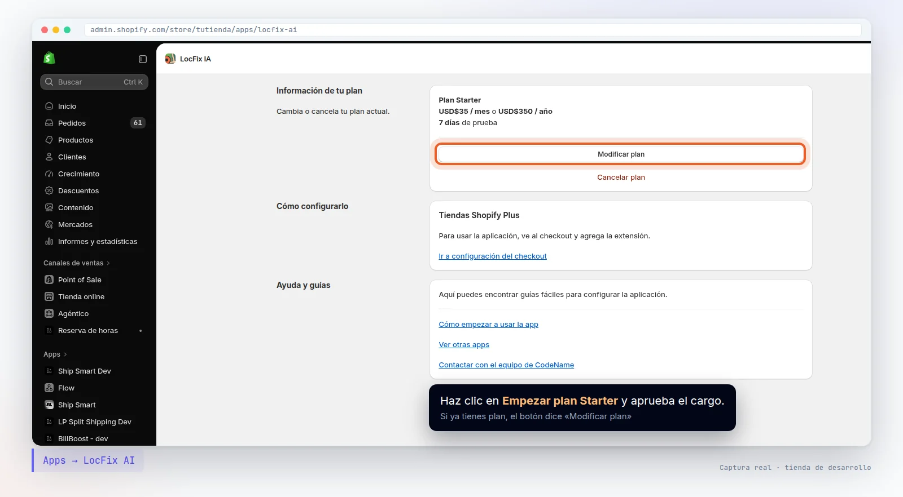
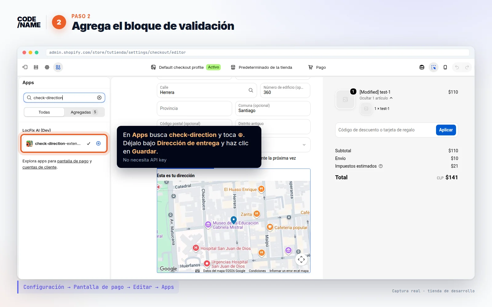
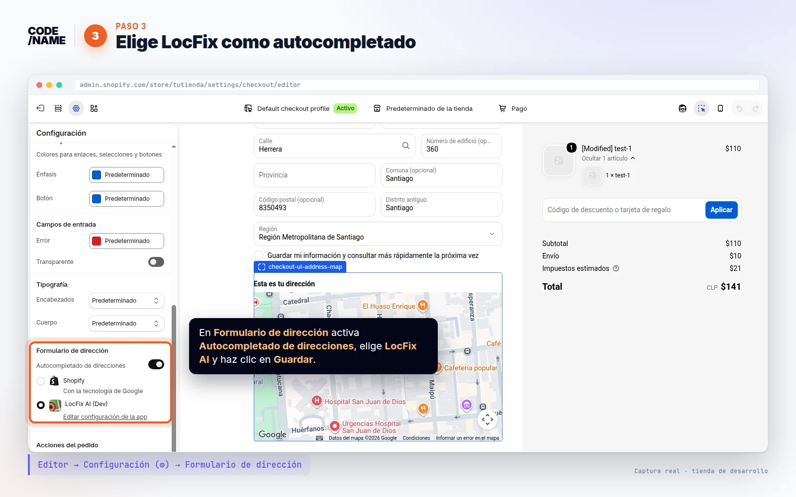
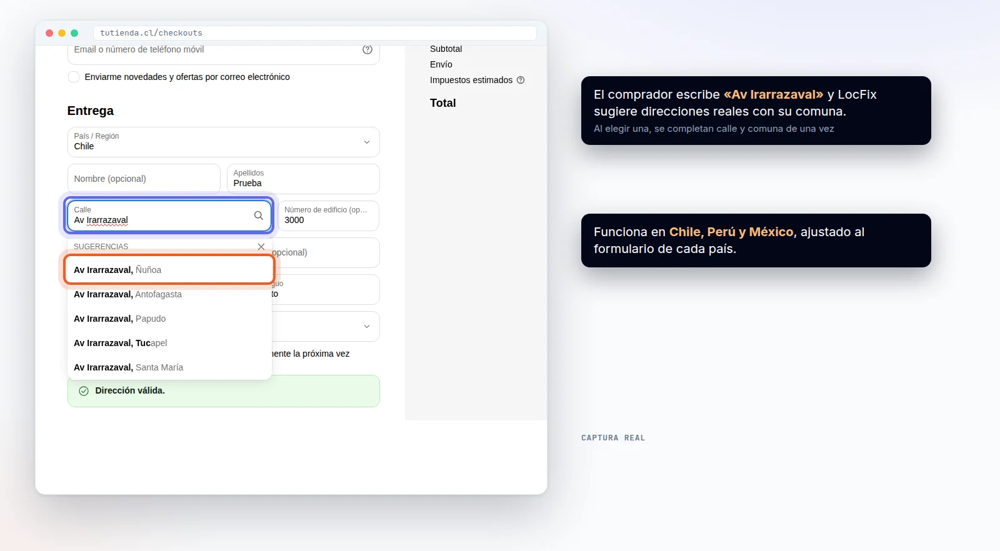
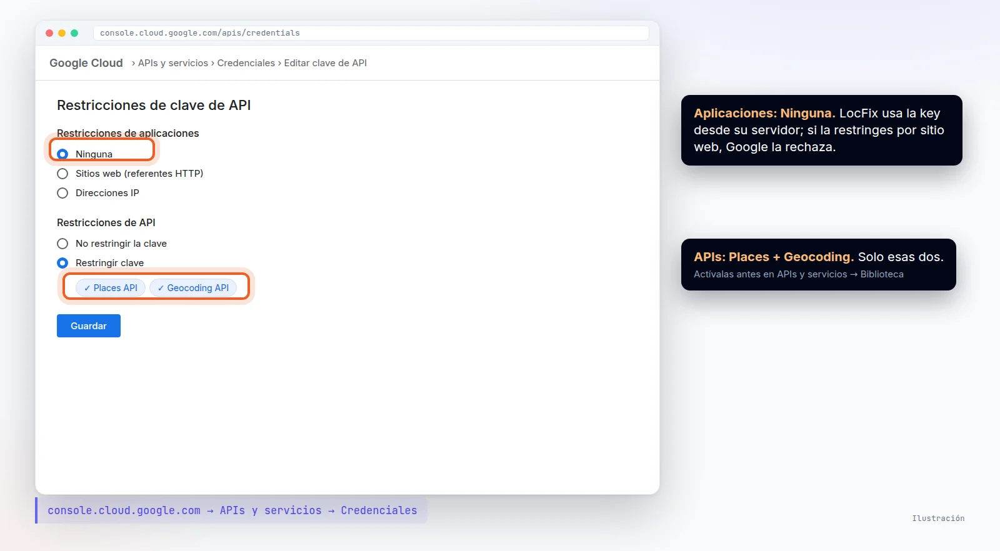
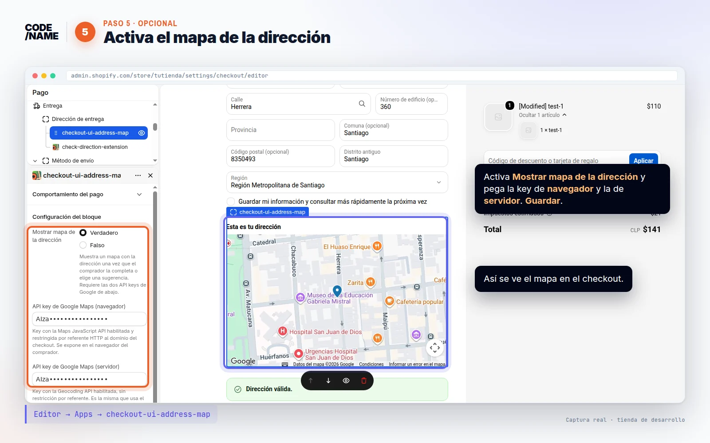
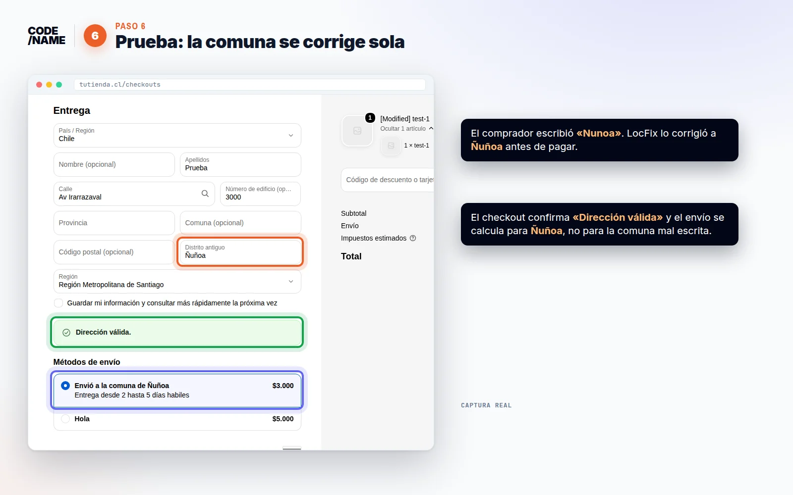

  

    Qué hace
    
Corrige la <b>comuna, distrito o municipio</b> mientras el comprador escribe, <b>autocompleta</b> direcciones reales y muestra un <b>mapa</b> del punto de entrega. Menos pedidos devueltos por direcciones mal escritas.

  

  

    Qué necesitas
    <ul>
      <li>Shopify con checkout personalizable (Checkout Extensibility)</li>
      <li>Cuenta de Google Cloud con facturación activa (solo para autocompletado y mapa)</li>
    </ul>
  

  

    Tiempo y países
    
<b>10 minutos</b> · 🇨🇱 Chile · 🇵🇪 Perú · 🇲🇽 México

  

  <a href="#paso-1"><b>1</b> Instalar y elegir plan</a>
  <a href="#paso-2"><b>2</b> Bloque de validación</a>
  <a href="#paso-3"><b>3</b> Autocompletado</a>
  <a href="#paso-4"><b>4</b> Key de Google</a>
  <a href="#paso-5"><b>5</b> Mapa <small>opcional</small></a>
  <a href="#paso-6"><b>6</b> Probar</a>

<h2 id="paso-1">1 Instala la app y elige tu plan</h2>

Shopify App Store → <a href="https://apps.shopify.com/validador-de-direcciones">LocFix AI</a> → Instalar

Al abrir la app verás tu plan. Haz clic en **Empezar plan Starter** y aprueba el cargo: los primeros días son de prueba gratis y puedes cancelar cuando quieras desde la misma pantalla.

<h2 id="paso-2">2 Agrega la validación de dirección al checkout</h2>

Configuración → Checkout → Personalizar → paso <b>Información</b>

1. Bajo la dirección de despacho, haz clic en **Agregar bloque de app**.
2. Elige **check-direction-extension** (validación de dirección de LocFix).
3. Haz clic en **Guardar**.

Con esto la validación ya funciona: si el comprador escribe *Nunoa*, LocFix la corrige a *Ñuñoa*; si la comuna no existe en la región elegida, le pide revisarla antes de continuar. **No necesita API key.**

<b>Personaliza los mensajes.</b> En la barra lateral del bloque puedes cambiar cada texto que ve el comprador (dirección válida, comuna inválida, sugerencia, error) y activar la casilla «Confirmo que mi dirección es correcta».

<h2 id="paso-3">3 Activa LocFix como autocompletado</h2>

Configuración → Checkout → <b>Autocompletado de direcciones</b>

Elige **LocFix AI** como proveedor y guarda. A partir de ahora las sugerencias que ve el comprador vienen de LocFix, ajustadas a cada país (en Chile, por ejemplo, completan la comuna correcta).

Así se ve en el checkout: el comprador escribe la calle y elige una dirección real con su comuna.

<h2 id="paso-4">4 Crea tu API key de Google (servidor)</h2>

<a href="https://console.cloud.google.com/">console.cloud.google.com</a> → APIs y servicios

1. **Biblioteca:** activa **Places API** y **Geocoding API**.
2. **Credenciales → Crear credenciales → Clave de API.**
3. Edita la key:
   - **Restricciones de API:** *Restringir clave* → solo **Places API** y **Geocoding API**.
   - **Restricciones de aplicaciones:** **Ninguna**.
4. Copia la key y pégala en el editor del checkout, bloque de autocompletado de LocFix, campo **Api google Maps**. Guarda.

<b>No la restrinjas por sitio web.</b> LocFix usa esta key desde su servidor, nunca en el navegador del comprador. Con una restricción de «referentes HTTP», Google la rechaza y el autocompletado deja de funcionar.

<h2 id="paso-5">5 Muestra un mapa de la dirección <small>opcional</small></h2>

Editor del checkout → Agregar bloque de app → <b>checkout-ui-address-map</b>

El mapa ayuda al comprador a confirmar dónde llega su pedido. Necesita **una segunda key**, de navegador:

| Campo del bloque de mapa | Qué key | APIs | Restricción |
| --- | --- | --- | --- |
| **API key de Google Maps (navegador)** | Una nueva | Maps JavaScript API | Sitios web: `https://tutienda.cl/*` y `https://tutienda.myshopify.com/*` |
| **API key de Google Maps (servidor)** | La del paso 4 | Places API + Geocoding API | Ninguna |

Activa **Mostrar mapa de la dirección**, pega las dos keys y guarda. Puedes ajustar el título, el zoom y el mensaje de ubicación aproximada.

<h2 id="paso-6">6 Prueba un checkout</h2>

Abre tu tienda, agrega un producto y ve al checkout. Escribe una dirección con la comuna mal escrita (*Nunoa*, *Stgo Centro*, *Penalolen*) y comprueba que:

- ✅ aparecen sugerencias de direcciones reales,
- ✅ la comuna se corrige sola,
- ✅ el mapa muestra el punto (si lo activaste).

## Problemas frecuentes

| Síntoma | Causa probable | Solución |
| --- | --- | --- |
| No aparecen sugerencias | LocFix no está elegido como proveedor | Paso 3 |
| No aparecen sugerencias | La key no tiene **Places API** o está restringida por sitio web | Paso 4: revisa las APIs y deja «Ninguna» en aplicaciones |
| «The provided API key is expired» o «API key not valid» | La key se borró o se regeneró en Google Cloud | Crea una nueva y pégala otra vez |
| El mapa no carga | La key de navegador no tiene **Maps JavaScript API** o no permite tu dominio | Paso 5 |
| La comuna no se corrige | Falta el bloque de validación en el paso Información | Paso 2 |

¿Algo no funciona? Escríbenos a <a href="mailto:soporte@codename.cl">soporte@codename.cl</a> con el nombre de tu tienda y te ayudamos a configurarlo.

